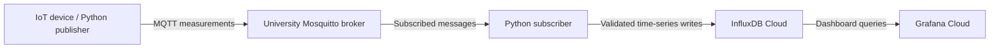

# Preliminary architecture

Status: design only; no runtime components or cloud integrations are implemented.

## Components and responsibilities

- **IoT device (`publishers/`):** acquire environmental measurements and publish JSON messages. Sensors and sampling intervals remain to be selected.
- **MQTT broker:** university Mosquitto at `10.6.1.10:1883`; distribute messages to matching subscribers. Confirm network access and course topic rules before testing.
- **Python subscriber (`subscribers/`):** receive messages, validate them, and eventually write measurements to InfluxDB Cloud.
- **Shared package (`shared/`):** centralize future environment configuration and message definitions.
- **InfluxDB Cloud:** store environmental time series and supporting analysis data. Schema, API/client version, and access configuration remain undecided.
- **Grafana Cloud:** query InfluxDB and visualize measurements, data gaps, and recovery behavior. Dashboard and data-source configuration remain future work.

## Configuration and credentials

`.env.example` provides the initial broker host, port, namespace placeholder, QoS, and keepalive. A local ignored `.env` will hold actual configuration. Configuration loading is not implemented. No cloud tokens, passwords, or real user credentials belong in version control.

## Network failure and recovery analysis

Plan baseline runs followed by controlled interruptions of device-to-broker and broker-to-subscriber connectivity. Define timing, observation points, and expected behavior before experiments. Cloud-write failures should be observed separately from MQTT failures.

Initial MQTT QoS is 0, so delivery is best effort. Automatic replay, persistent buffering, reconnection behavior, and database retries must be explicitly designed and tested; this architecture does not promise them. Candidate metrics include sequence gaps, delivery counts, outage duration, and time to first successful message after reconnection. Latency measurements require a defined clock synchronization strategy.

Topic hierarchy, JSON schema, timestamp semantics, and identifiers will be specified in [mqtt_design.md](mqtt_design.md). Record design choices and experimental evidence in [engineering_logbook.md](engineering_logbook.md).
